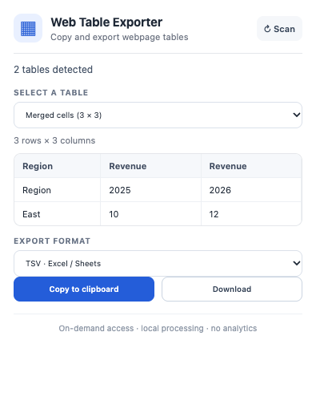

# Web Table Exporter

Copy an HTML table from a webpage into Excel or Google Sheets, or export it as CSV, TSV, Markdown, or JSON. Web Table Exporter is a free, open-source Chrome extension that scans the current page only when you open it. Data stays in your browser.

Use it to copy a website table to Excel, save a web table to CSV, prepare a Markdown table for GitHub, or extract JSON for a local data workflow.

**GitHub-only distribution:** this project is not listed in the Chrome Web Store. You install it through Chrome's Developer Mode.



## What it does

- Finds visible, top-level HTML `<table>` elements in the active page.
- Lets you choose a table and preview its first rows before exporting.
- Copies TSV to the clipboard for pasting a website table into Excel or Google Sheets.
- Downloads CSV, TSV, GitHub-flavored Markdown, or JSON as an array of arrays.
- Expands ordinary `rowspan` and `colspan` cells into a rectangular grid.
- Protects likely spreadsheet formulas in CSV and TSV while preserving signed numeric values.
- Runs locally after you invoke the extension. There is no account, backend, telemetry, or network request.

## Install a release

1. Download the ZIP from [GitHub Releases](https://github.com/FaisalHafeez/web-table-exporter/releases/latest).
2. Extract the ZIP. It contains the built extension files directly.
3. Open `chrome://extensions` in Chrome or a compatible Chromium browser.
4. Turn on **Developer mode**, choose **Load unpacked**, and select the extracted folder containing `manifest.json`.
5. Pin Web Table Exporter, open a page with an HTML table, and click the extension.

Node.js and Bun are not needed to install a release. Review the source and permissions before loading any unpacked extension.

## Use it

1. Open a webpage containing a regular HTML table.
2. Click the extension. It scans that page on demand.
3. Select a detected table and check the preview and dimensions.
4. Choose TSV, CSV, Markdown, or JSON, then copy or download it.

Try the local [HTML fixture](tests/fixture.html), which includes merged cells, Unicode, a formula-like value, and a hidden table.

For example, a table with `Name` and `Count` columns can be exported as:

```csv
Name,Count
Alpha,4
Beta,10
```

or JSON:

```json
[["Name","Count"],["Alpha","4"],["Beta","10"]]
```

## Limits

- Reads actual HTML tables in the main page frame. It does not extract CSS grids, PDF tables, iframe contents, paginated data, or virtualized rows that are not in the DOM.
- Exports cell text; it does not preserve formulas, images, styles, or rich HTML.
- Caps a scan at 25 tables, 1,500 rows per table, 60 columns, and about 250,000 cell-text characters. The popup marks partial results.
- Handles common positive row and column spans. `rowspan="0"` and malformed layouts may differ from spreadsheet behavior.
- Formula protection is applied to CSV and TSV. JSON and Markdown preserve the original text.
- Chrome internal pages and other browser-controlled pages cannot be scanned.

## Build from source

Requires Bun 1.2+ and Node.js 22.18+.

```sh
bun install --frozen-lockfile
bun run dev
```

For a production build and installable ZIP:

```sh
bun run build
bun run zip
```

The unpacked production build is in `.output/chrome-mv3/`. The ZIP is emitted in `.output/`.

## Development and tests

```sh
bun run test:unit
bun run build
bun run test:e2e
bun run test
```

The Playwright end-to-end suite loads the built extension in Chromium and exercises table discovery, selection, preview, real clipboard writes, downloads, no-table pages, and restricted pages. Its test-only build adds permission for the local fixture server; the production manifest has no host permissions and requests only `activeTab` and `scripting`.

## Privacy and permissions

The production extension requests only:

- `activeTab` to access the tab after you invoke the extension.
- `scripting` to run the table scanner in that page.

The scanner processes the current page locally. The extension has no background worker, broad website access, clipboard-read permission, account, analytics, or remote service.

## Contributing

Bug reports are most useful with a small public HTML example, expected output, and actual output. Keep changes focused on table extraction, export correctness, accessibility, and reproducible tests. Do not include private page content in issues.

## License

MIT. See [LICENSE](LICENSE).
